<div align="center">

<picture>
  <source media="(prefers-reduced-motion: reduce)" srcset=".github/assets/banner-static.svg" />
  
</picture>

<br>
<br>

**Production-ready authentication for Express 5 and MongoDB.**

<a href="https://nodejs.org"></a>
<a href="https://expressjs.com"></a>
<a href="https://mongoosejs.com"></a>
<a href="https://jwt.io"></a>
<br>
<a href="https://www.npmjs.com/package/bcrypt"></a>
<a href="LICENSE"></a>
<a href="https://github.com/jyotir-dev/express-auth-kit/pulls"></a>

<br>

<a href="https://github.com/jyotir-dev/express-auth-kit/generate"></a>

<p>
  <a href="#quick-start">Quick start</a> ·
  <a href="#usage">Usage</a> ·
  <a href="#api">API</a> ·
  <a href="#errors">Errors</a> ·
  <a href="#security">Security</a> ·
  <a href="#deployment">Deployment</a>
</p>

</div>

## Why AuthKit

Most starters stop at a login route and a token in `localStorage`. AuthKit covers the whole account lifecycle, from signup and email verification to password reset and signing out every device, with the defences that usually get skipped: hashed tokens, revocable sessions, no account enumeration and per-route rate limits.

It's plain Express, so there's no framework to learn. Clone it, read it in an afternoon, and build on top.

## Features

- **Accounts:** signup, login, logout and the current user
- **Email verification:** single-use links, with resend
- **Password reset:** forgot, reset, and a check route so your reset page can reject dead links on load
- **Password change:** signs the user out of every device
- **Route guards:** `requireAuth()`, `requireVerified()` and `requireRole()` for your own routes
- **Roles:** every account has a role (`user` or `admin`), and routes can be limited to one or more roles
- **Transactional emails:** branded HTML for every flow, with plain-text versions
- **Consistent errors:** every failure returns `{ success, code, message }`, including malformed and oversized request bodies

## Quick start

You'll need **Node.js 22+**, a **MongoDB** database and an **SMTP** account.

```sh
git clone https://github.com/jyotir-dev/express-auth-kit.git
cd express-auth-kit
npm install
cp .env.example .env   # then fill it in
npm run dev
```

The API runs on `http://localhost:5000`, and `GET /api/health` confirms it's up. `npm run dev` restarts on every save; use `npm start` in production.

<details>
<summary><b>Environment variables</b></summary>

<br>

| Variable | Description |
| --- | --- |
| `NODE_ENV` | `development` or `production` |
| `PORT` | Port the API listens on (default `5000`) |
| `CLIENT_URL` | Your frontend's URL, used for CORS and email links |
| `MONGO_URI` | MongoDB connection string |
| `JWT_SECRET` | Long random secret used to sign sessions |
| `SMTP_HOST` `SMTP_PORT` `SMTP_USER` `SMTP_PASS` | Outgoing mail server |
| `EMAIL_FROM` | Sender, e.g. `"Your App <no-reply@example.com>"` |
| `APP_NAME` | Your app's name in emails and on database connections (defaults to `AuthKit`) |

Generate a strong `JWT_SECRET` with:

```sh
node -e "console.log(require('crypto').randomBytes(64).toString('hex'))"
```

</details>

## Usage

### Call the API from your frontend

Sessions live in an httpOnly cookie, so the browser stores and sends them for you. Just include credentials on every request:

```js
await fetch('http://localhost:5000/api/v1/auth/login', {
    method: 'POST',
    credentials: 'include',
    headers: { 'Content-Type': 'application/json' },
    body: JSON.stringify({ username, password })
});
```

### Protect your own routes

```js
const requireAuth = require('../middlewares/auth.middleware');
const requireRole = require('../middlewares/role.middleware');
const requireVerified = require('../middlewares/verification.middleware');

const { USER_ROLE } = require('../enums/user.enums');

router.get('/projects', requireAuth(), projectController.list);
router.post('/projects', requireAuth(), requireVerified(), projectController.create);
router.delete('/projects/:id', requireAuth(), requireRole(USER_ROLE.ADMIN), projectController.remove);
```

`requireAuth()` loads the signed-in user onto `req.user`. `requireVerified()` rejects accounts that haven't confirmed their email with `403 EMAIL_NOT_VERIFIED`. `requireRole()` rejects users whose role isn't listed with `403 AUTH_FORBIDDEN_ROLE`, and always goes after `requireAuth()`.

### Roles

Every account starts as `user`. Roles live in `src/enums/user.enums.js`:

```js
const USER_ROLE = Object.freeze({
    USER: 'user',
    ADMIN: 'admin'
});
```

Pass one role or several. A user gets through if their role is any of them:

```js
requireRole(USER_ROLE.ADMIN)
requireRole(USER_ROLE.ADMIN, USER_ROLE.SUPPORT)   // after adding SUPPORT to USER_ROLE
```

To add a role, add it to `USER_ROLE`. Each route lists exactly who can use it; there's no hierarchy, so an admin isn't let through a route that only lists `support`.

No API route can set a role, so a request can never promote itself. Make someone an admin directly in the database:

```js
db.users.updateOne({ username: 'maya' }, { $set: { role: 'admin' } })
```

The role is read from the database on every request, not stored in the session cookie, so a promotion or demotion takes effect on the user's next request.

### Add a feature the same way

Every route reads top to bottom: limit, authenticate, validate, handle.

```js
router.post(
    '/projects',
    rateLimit(projectLimits.create),
    requireAuth(),
    requireVerified(),
    validateRequest(projectValidator.create),
    projectController.create
);
```

A validator is a plain function that throws when the request is wrong:

```js
// validators/project.validator.js
const { BadRequestError } = require('../errors/http.errors');

exports.create = (params, body, query) => {
    if (typeof body.name !== 'string' || !body.name.trim()) {
        throw new BadRequestError('Project name is required.');
    }
};
```

<details>
<summary><b>Middleware conventions</b></summary>

<br>

- Every middleware is a factory: always call it, as in `requireAuth()`, `rateLimit(limits)`, `validateRequest(validator)`.
- Names start with a verb that says what happens, and each file is named after its concern.
- Order on every route: `rateLimit → requireAuth → requireVerified → requireRole → validateRequest → controller`. Cheap checks run first.

| File | Export | Used in |
| --- | --- | --- |
| `auth.middleware.js` | `requireAuth()` | routes |
| `verification.middleware.js` | `requireVerified()` | routes |
| `role.middleware.js` | `requireRole(...roles)` | routes |
| `ratelimit.middleware.js` | `rateLimit(limits)` | routes |
| `validation.middleware.js` | `validateRequest(validator)` | routes |
| `logger.middleware.js` | `logRequest()` | `app.js` |
| `notfound.middleware.js` | `handleNotFound()` | `app.js` |
| `error.middleware.js` | `handleError()` | `app.js` |

</details>

## API

All routes live under `/api/v1/auth`. Sessions travel in an httpOnly `token` cookie, so send requests with credentials.

| Method | Route | Auth | Description |
| --- | --- | :---: | --- |
| `POST` | `/signup` | | Create an account and send a verification email |
| `POST` | `/login` | | Log in |
| `GET` | `/me` | ✓ | Get the signed-in user |
| `POST` | `/logout` | | Log out |
| `PATCH` | `/password` | ✓ | Change password and sign out every device |
| `POST` | `/verify-email` | | Verify an email address |
| `POST` | `/verify-email/resend` | ✓ | Send a new verification link |
| `POST` | `/forgot-password` | | Send a password reset link |
| `POST` | `/reset-password/verify` | | Check that a reset link is still valid |
| `POST` | `/reset-password` | | Set a new password |

<details>
<summary><b>Request bodies and responses</b></summary>

<br>

| Route | Body |
| --- | --- |
| `/signup` | `{ username, email, password }` |
| `/login` | `{ username, password }` |
| `/password` | `{ currentPassword, newPassword }` |
| `/verify-email`, `/reset-password/verify` | `{ token }` |
| `/forgot-password` | `{ email }` |
| `/reset-password` | `{ token, password }` |

Usernames are 3–32 letters, numbers or underscores. Passwords are 8–72 characters.

```jsonc
// 201 Created · POST /signup
{
  "success": true,
  "message": "Account created successfully.",
  "user": {
    "id": "6650f1c2a9e4b3d2c1f0e9a8",
    "username": "maya",
    "email": "maya@example.com",
    "emailVerified": false,
    "createdAt": "2026-10-26T11:58:00.000Z"
  }
}
```

</details>

## Errors

Every error has the same shape, so your frontend can branch on `code` and show `message`:

```jsonc
// 401 Unauthorized · POST /login
{
  "success": false,
  "code": "INVALID_CREDENTIALS",
  "message": "Invalid username or password."
}
```

<details>
<summary><b>Error codes</b></summary>

<br>

| Status | Code | When |
| :---: | --- | --- |
| 400 | `BAD_REQUEST` | A field is missing or invalid; `message` says which |
| 400 | `INVALID_JSON` | The request body isn't valid JSON |
| 400 | `INVALID_VERIFICATION_TOKEN` | The verification link is wrong, used or expired |
| 400 | `INVALID_RESET_TOKEN` | The reset link is wrong, used or expired |
| 400 | `INVALID_CURRENT_PASSWORD` | The current password doesn't match |
| 400 | `PASSWORD_REUSED` | The new password equals the current one |
| 400 · 401 | `INVALID_CREDENTIALS` | Wrong username or password |
| 401 | `AUTH_REQUIRED` | No session cookie |
| 401 | `INVALID_TOKEN` | The session cookie is invalid or expired |
| 401 | `SESSION_EXPIRED` | The session was ended by a password change or reset |
| 401 | `USER_NOT_FOUND` | The account no longer exists |
| 403 | `EMAIL_NOT_VERIFIED` | The route needs a verified email |
| 403 | `AUTH_FORBIDDEN_ROLE` | The user's role isn't allowed on this route |
| 404 | `ROUTE_NOT_FOUND` | No such route |
| 409 | `USER_ALREADY_EXISTS` | The username or email is taken |
| 409 | `EMAIL_ALREADY_VERIFIED` | Resend was called on a verified account |
| 409 | `PASSWORD_CHANGED` | Another request changed the password first |
| 413 | `PAYLOAD_TOO_LARGE` | The body is over 10 kB |
| 429 | `TOO_MANY_REQUESTS` | A rate limit was hit; try again later |
| 500 | `INTERNAL_SERVER_ERROR` | Something broke on the server; details are logged, never sent |

</details>

## Security

| Threat | How AuthKit handles it |
| --- | --- |
| Database leak | Passwords are hashed with bcrypt (12 rounds). Verification and reset tokens are stored only as SHA-256 hashes. |
| Stolen session | Sessions live in an httpOnly cookie (`SameSite=Lax`, `Secure` in production) and last 7 days. A password change or reset ends every existing session. |
| Reused links | Tokens are single use and expire: 24 hours for verification, 60 minutes for reset. |
| Account enumeration | Login runs a full bcrypt check even for unknown usernames, and forgot-password answers the same either way. |
| Brute force | Per-route rate limits, from 10 failed logins per 15 minutes to 5 emails per hour. |
| Request abuse | Helmet headers, CORS locked to your client, and a 10 kB body limit with clean `400` and `413` errors. |
| Privilege escalation | No route accepts a `role`, so accounts can't promote themselves. Roles are checked against the database on every request, so a demotion applies immediately. |
| Race conditions | State changes are conditional atomic updates, so two concurrent requests can't both succeed. |

<details>
<summary><b>Rate limits</b></summary>

<br>

| Routes | Limit |
| --- | --- |
| `/login` | 10 failed attempts per 15 minutes |
| `/signup` | 5 per hour |
| `/password` | 5 failed attempts per 15 minutes |
| `/verify-email/resend`, `/forgot-password` | 5 per hour |
| `/verify-email`, `/reset-password`, `/reset-password/verify` | 10 per 15 minutes |

Each route keeps its own counter. Change the numbers in `src/limits/auth.limits.js`.

</details>

Found a vulnerability? Please [report it privately](https://github.com/jyotir-dev/express-auth-kit/security/advisories/new) rather than opening a public issue.

## Deployment

1. **Set `NODE_ENV=production`.** Cookies become `Secure` (HTTPS only), and the app trusts the first proxy so rate limits see real client IPs.
2. **Serve the API and frontend from the same site**, for example `app.example.com` and `api.example.com`. The session cookie is `SameSite=Lax`, so browsers only send it within one site. If they must live on different domains, switch the cookie to `SameSite=None` in `src/utils/auth-cookie.js`.
3. **Set `CLIENT_URL` to your frontend's exact origin.** CORS only accepts that origin, and email links point there.
4. **Use a long random `JWT_SECRET`**, and keep `.env` out of version control.

## Project structure

```
src/
├── server.js       starts the server and connects the database
├── app.js          global middlewares and route mounting
├── config/         database connection
├── routes/         URLs, wired to limits, guards, validators and controllers
├── limits/         rate limits per route
├── validators/     request checks
├── controllers/    HTTP in, HTTP out
├── services/       the auth logic
├── middlewares/    guards, roles, rate limiting, validation, logging and errors
├── models/         User
├── enums/          user roles
├── errors/         typed HTTP errors
├── security/       JWT and token hashing
├── mailers/        when each email is sent
├── emails/         what each email looks like
├── lib/            logger
└── utils/          auth cookie and async helpers
```

Every request moves through `routes → limits → validators → controllers → services`, so each layer has one job and is easy to find.

## License

Distributed under the MIT License. See [LICENSE](LICENSE) for details.