<div align="center">

<picture>
  <source media="(prefers-reduced-motion: reduce)" srcset=".github/assets/banner-static.svg" />
  
</picture>

<br>
<br>

**Production-ready authentication for Express 5 and MongoDB.**

<a href="https://nodejs.org"></a>
<a href="https://expressjs.com"></a>
<a href="https://mongoosejs.com"></a>
<a href="https://jwt.io"></a>
<br>
<a href="https://www.npmjs.com/package/bcrypt"></a>
<a href="LICENSE"></a>
<a href="https://github.com/jyotir-dev/express-auth-kit/pulls"></a>

<br>

<a href="https://github.com/jyotir-dev/express-auth-kit/generate"></a>

<p>
  <a href="#quick-start">Quick start</a> ·
  <a href="#api">API</a> ·
  <a href="#security">Security</a> ·
  <a href="#project-structure">Structure</a>
</p>

</div>

## Why AuthKit

Most starters stop at a login route and a token in `localStorage`. AuthKit covers the whole account lifecycle, from signup and email verification to password reset and signing out every device, with the defences that usually get skipped: hashed tokens, revocable sessions, no account enumeration and per-route rate limits.

It's plain Express, so there's no framework to learn. Clone it, read it in an afternoon, and build on top.

## Features

- **Accounts:** signup, login, logout and the current user
- **Email verification:** single-use links, with resend
- **Password reset:** forgot, reset, and a check route so your reset page can reject dead links on load
- **Password change:** signs the user out of every device
- **Route guards:** `requireAuth` and `requireVerified` for your own routes
- **Transactional emails:** dark, branded HTML for every flow, with plain-text versions
- **Consistent errors:** every failure returns `{ success, code, message }`

## Quick start

You'll need **Node.js 22+**, a **MongoDB** database and an **SMTP** account.

```sh
git clone https://github.com/jyotir-dev/express-auth-kit.git
cd express-auth-kit
npm install
cp .env.example .env   # then fill it in
npm start
```

The API runs on `http://localhost:5000`, and `GET /api/health` confirms it's up.

<details>
<summary><b>Environment variables</b></summary>

<br>

| Variable | Description |
| --- | --- |
| `NODE_ENV` | `development` or `production` |
| `PORT` | Port the API listens on (default `5000`) |
| `CLIENT_URL` | Your frontend's URL, used for CORS and email links |
| `MONGO_URI` | MongoDB connection string |
| `JWT_SECRET` | Long random secret used to sign sessions |
| `SMTP_HOST` `SMTP_PORT` `SMTP_USER` `SMTP_PASS` | Outgoing mail server |
| `EMAIL_FROM` | Sender, e.g. `"Your App <no-reply@example.com>"` |
| `APP_NAME` | Your app's name in emails (defaults to `AuthKit`) |

</details>

## Usage

Protect your own routes with the two guards:

```js
const requireAuth = require('./middlewares/auth.middleware');
const requireVerified = require('./middlewares/verified.middleware');

router.get('/projects', requireAuth, projectController.list);
router.post('/projects', requireAuth, requireVerified, projectController.create);
```

`requireAuth` loads the signed-in user onto `req.user`. `requireVerified` rejects accounts that haven't confirmed their email with `403 EMAIL_NOT_VERIFIED`.

## API

All routes live under `/api/v1/auth`. Sessions travel in an httpOnly `token` cookie, so send requests with credentials.

| Method | Route | Auth | Description |
| --- | --- | :---: | --- |
| `POST` | `/signup` | | Create an account and send a verification email |
| `POST` | `/login` | | Log in |
| `GET` | `/me` | ✓ | Get the signed-in user |
| `POST` | `/logout` | | Log out |
| `PATCH` | `/password` | ✓ | Change password and sign out every device |
| `POST` | `/verify-email` | | Verify an email address |
| `POST` | `/verify-email/resend` | ✓ | Send a new verification link |
| `POST` | `/forgot-password` | | Send a password reset link |
| `POST` | `/reset-password/verify` | | Check that a reset link is still valid |
| `POST` | `/reset-password` | | Set a new password |

<details>
<summary><b>Request bodies and responses</b></summary>

<br>

| Route | Body |
| --- | --- |
| `/signup` | `{ username, email, password }` |
| `/login` | `{ username, password }` |
| `/password` | `{ currentPassword, newPassword }` |
| `/verify-email`, `/reset-password/verify` | `{ token }` |
| `/forgot-password` | `{ email }` |
| `/reset-password` | `{ token, password }` |

Usernames are 3–32 letters, numbers or underscores. Passwords are 8–72 characters.

```jsonc
// 201 Created · POST /signup
{
  "success": true,
  "message": "Account created successfully.",
  "user": {
    "id": "6650f1c2a9e4b3d2c1f0e9a8",
    "username": "maya",
    "email": "maya@example.com",
    "emailVerified": false,
    "createdAt": "2026-10-26T11:58:00.000Z"
  }
}
```

```jsonc
// 401 Unauthorized · POST /login
{
  "success": false,
  "code": "INVALID_CREDENTIALS",
  "message": "Invalid username or password."
}
```

</details>

## Security

| Threat | How AuthKit handles it |
| --- | --- |
| Database leak | Passwords are hashed with bcrypt (12 rounds). Verification and reset tokens are stored only as SHA-256 hashes. |
| Stolen session | Sessions live in an httpOnly cookie (`SameSite=Lax`, `Secure` in production). A password change or reset ends every existing session. |
| Reused links | Tokens are single use and expire: 24 hours for verification, 60 minutes for reset. |
| Account enumeration | Login runs a full bcrypt check even for unknown usernames, and forgot-password answers the same either way. |
| Brute force | Per-route rate limits: 10 failed logins per 15 minutes, 5 emails per hour. |
| Request abuse | Helmet headers, CORS locked to your client and a 10 kB body limit. |
| Race conditions | State changes are conditional atomic updates, so two concurrent requests can't both succeed. |

Found a vulnerability? Please [report it privately](https://github.com/jyotir-dev/express-auth-kit/security/advisories/new) rather than opening a public issue.

## Project structure

```
src/
├── routes/        URLs, wired to limits, validators and controllers
├── limits/        rate limit per route
├── validators/    request checks
├── controllers/   HTTP in, HTTP out
├── services/      the auth logic
├── middlewares/   requireAuth, requireVerified, errors
├── models/        User
├── security/      JWT and token hashing
├── mailers/       when each email is sent
└── emails/        what each email looks like
```

Every request moves through `routes → limits → validators → controllers → services`, so each layer has one job and is easy to find.

## License

Distributed under the MIT License. See [LICENSE](LICENSE) for details.
